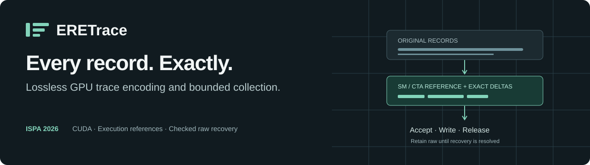

<p align="center"></p>

<p align="center">
<a href="https://github.com/DQR-Happy/ERETrace/releases/tag/v1.0.0"></a>
<a href="docs/CITATION.md"></a>
<a href="docs/INSTALL.md"></a>
<a href="LICENSE"></a>
</p>

<p align="center"><a href="https://dengqirui.me/ERETrace/"><b>Project home</b></a> · <a href="docs/INSTALL.md">Install</a> · <a href="docs/REPRODUCE.md">Reproduce</a> · <a href="docs/ARCHITECTURE.md">Architecture</a> · <a href="docs/README.zh-CN.md">简体中文</a></p>

**ERETrace** is the research implementation of **Execution-Reference Encoding and Recovery-Aware Collection for GPU Profiling**, accepted at **ISPA 2026**.
It compresses fine-grained GPU execution records within SM/CTA reference domains and carries them through a bounded asynchronous collector. Every captured field remains exactly recoverable; out-of-range records follow a checked raw path.

## Why ERETrace

- **Execution-aware encoding.** Use execution-local references, checked narrow integers and exclusive packing to reduce trace traffic.
- **Recovery-aware ownership.** Retain raw records until acceptance and output resolve; recover without replaying the kernel.
- **Complete-request measurement.** Include inference, probing, synchronization, encoding/recovery, D2H, drain and trace file close.
- **Reproducible comparisons.** Matched serial/async raw, field-aware nvCOMP and reference ablations, with process-level paired rounds.

The primary implementation extends [Neutrino](https://github.com/open-neutrino/neutrino). Its probing frontend and authorship remain distinct from ERETrace's encoding and collection contributions. The `neutrino` Python namespace is retained for compatibility.

## Quick start

Python 3.10–3.12, Git and a C compiler are sufficient for CPU tests and retained-table regeneration. Capture additionally requires **Linux + NVIDIA CUDA**. Models and vendor SDKs are obtained separately.

```bash
git clone https://github.com/DQR-Happy/ERETrace.git
cd ERETrace
python3 -m venv .venv
source .venv/bin/activate
python scripts/bootstrap.py
python -m pip install -e '.[test]'
python -m unittest discover -s tests -p 'test_*.py' -v
python scripts/summarize_paper.py
```

Bootstrap downloads the pinned Neutrino source, applies our published patches, and checks every reconstructed file against SHA-256. It never installs or replaces a system driver. See [dependency boundaries](THIRD_PARTY_NOTICES.md) and [installation](docs/INSTALL.md).

### Build and capture on a CUDA host

Build the [pinned llama.cpp dependency](docs/INSTALL.md), obtain a model matching [the model manifest](configs/models.json), then:

```bash
python scripts/build.py --arch 86   --llama-source external/llama.cpp --llama-build external/llama.cpp/build
python scripts/reproduce.py   --model models/Qwen3-8B-Q4_K_M.gguf --backend external/llama.cpp/build/bin   --conditions native ours --input-tokens 256 --output-tokens 64   --context 4096 --batch-size 1 --warmup 2 --requests 3 --rounds 7   --output outputs/qwen3-primary
```

Use `--dry-run` to inspect the command and environment first. Full comparisons add `serial async nvcomp`; nvCOMP requires its external SDK. Model weights are never downloaded implicitly; ModelScope is the preferred download source when the exact recorded artifact is available.

## Paper results

RTX 3090 · 256 input / 64 output tokens · B=1 · seven process rounds, three requests per round. **Latency ends at complete trace file close.** GB is decimal file size. These are retained paper measurements, not newly measured release benchmarks.

| Model | Serial raw, ms | Async raw, ms | nvCOMP, ms / GB | ERETrace, ms / GB |
|:--|--:|--:|--:|--:|
| Qwen3-8B | 11,308.96 | 1,676.78 | 703.67 / 1.941 | **624.70 / 1.303** |
| Llama3.2-1B | 4,635.39 | 560.97 | 228.62 / 0.643 | **174.00 / 0.441** |
| Gemma3-4B | 12,027.70 | 1,413.66 | 558.40 / 1.598 | **485.81 / 1.081** |

Relative to the matched nvCOMP collector, complete-request latency falls **11.22–23.89%** and file volume falls **31.44–32.86%**. In the real document-QA case, latency is **1,295.48 ms** versus **1,808.42 ms**, a **28.36%** reduction. Hardware, scope, controls and failures matter: see [results](docs/RESULTS.md), [case data](results/paper/case-portability-results.json) and [reproduction coverage](docs/EXPERIMENTS.md).

## Explore the implementation

| Area | Start here |
|:--|:--|
| Exact CUDA encoding and record restoration | [Encoder](benchmarks/capture_pack.cu) · [Decoder](benchmarks/trace_codec.py) |
| Bounded pipeline and raw retention | [Arena runtime](neutrino/src/arena_capture.h) · [Architecture](docs/ARCHITECTURE.md) |
| Baselines and mechanism controls | [Condition manifest](configs/conditions.json) · [Paired runner](scripts/reproduce.py) |
| Batch and sequence sensitivity | [B16 adapter](experiments/b16/llama_adapter_batch16.cpp) · [Guide](docs/REPRODUCE.md) |
| Real document-QA case | [Source and commands](docs/DOCUMENT_QA.md) |
| NVBit / XTrace portability | [Integration guide](docs/FRONTENDS.md) |
| Variable-event capacity analysis | [Prototype](neutrino/probe/core_capacity.py) · [Certified experiment](benchmarks/run_certified_core.py) |
| Exact dependency reconstruction | [Bootstrap](scripts/bootstrap.py) · [Runtime manifest](provenance/upstream-runtime.json) |

NVBit uses its SASS frontend. The included XTrace experiment uses GWatch/PTX replacement and compares Sparse with Sparse + ERE; it does not claim to implement XTrace's native SASS rewriting engine. The capacity-analysis prototype has its own supported PTX subset.

## Repository map

```text
benchmarks/       CUDA codecs, workload adapters and correctness drivers
neutrino/         ERETrace additions; inherited files restored by bootstrap
patches/          Published changes against the pinned Neutrino dependency
experiments/      B16, document QA, NVBit, XTrace and Jetson source
configs/          Matched condition settings and model identities
scripts/          Bootstrap, build, paired runs, case runner and packaging
tests/            Exact formats, fallback, bounds and allocator invariants
results/          Retained scalar measurements; no model weights or raw traces
docs/             Guides, architecture, validation and project homepage
provenance/       Source identities and release integrity manifest
```

## Validation and scope

[VALIDATION.md](docs/VALIDATION.md) records checks actually performed for this release. Preserve the `provenance/RELEASE-MANIFEST.json` file and run `python scripts/check_repository.py` after bootstrap to verify the release and reconstructed runtime.

The primary full-trace path supports the profiled `block_sched` scope on Linux CUDA with CUDA Graphs disabled. It preserves the records within that declared scope; it is not a claim of universal interception of every vendor kernel or framework. Separate extra SHA/oracle validation from timed performance runs. See [contribution rules](CONTRIBUTING.md) for the exactness and timing contract.

## Citation and license

**Qirui Deng, Yongxian Fan, Yongwei Zhang, and Zuwen Lai.** *Execution-Reference Encoding and Recovery-Aware Collection for GPU Profiling.* ISPA 2026, accepted. [BibTeX and Neutrino citation](docs/CITATION.md) · [CITATION.cff](CITATION.cff).

Our additions, patches, documentation and original artwork are **MIT-licensed**. Third-party code and dependencies retain their own terms; the Neutrino frontend is fetched directly from upstream, not relicensed by this repository. Read [LICENSE](LICENSE) and [THIRD_PARTY_NOTICES.md](THIRD_PARTY_NOTICES.md).
