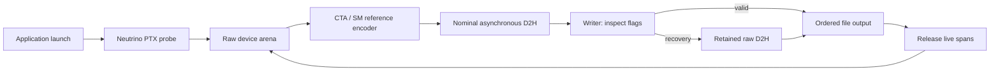

# Architecture and source guide

## Fixed-record capture

This is the research data path, not a new LLM operator implementation. `cuda.c` intercepts supported driver launches. `probe/cuda.py` extracts and rewrites PTX; `reference_core.py` and `core_codegen.py` implement alternative indexing paths. `tools/block_sched.py` declares the original 16-byte per-warp record. The application executes each covered model kernel once.

## Exact representation

The original record has a uint64 start timestamp, uint32 elapsed interval, and uint32 SM ID. The reference codec uses a per-SM base and, for grouped layouts, CTA-local references. The primary configuration uses signed 24-bit group deltas, signed 12-bit local deltas and 16-bit elapsed fields with explicit range checks. For small CTA warp counts it uses the flat layout. The reference-zero entry is omitted where implied by the layout. Four 12-bit deltas are packed into six exclusively owned bytes.

`clock64` belongs to an SM clock domain. SM-local references preserve the sampled integer values; they do not calibrate a cross-SM global timeline. Restoration is modulo uint64, and every narrowed field must satisfy its range check. The CPU format tests and GPU oracle exercise extreme values and fallback flags.

## Bounded ownership and recovery

The arena uses monotonic logical positions and physical wrap padding. A producer reserves raw/device/output spans before publishing a segment. The copy stream waits for kernel completion, encodes, and enqueues the nominal payload transfer. The writer consumes in FIFO order, checks flags, completes the output, and releases ownership.

A failed encoded Map uses retained raw device data. This source version allocates **pageable host recovery staging with `malloc`**, and performs synchronous raw D2H from the writer. It is not a pre-reserved pinned buffer. Recovery is bounded by the current head segment; it does not reserve from the occupied normal host ring. Allocation/driver/output failures fail the capture rather than overwrite live bytes. The writer keeps raw data alive until the recovery and file output complete.

The primary `host=128 MiB`, `raw=64 MiB`, `encoded=64 MiB` budgets describe pools, not total process memory. Descriptors, codec workspace, recovery staging, model state and tmpfs file pages are separate. `nvcomp_pipeline.cu` exposes its additional device/host allocation through `nvpipe_space`.

## Module responsibilities

| Path | Responsibility |
|---|---|
| `neutrino/cli.py` | Probe compilation, environment setup and child-process launch |
| `neutrino/language/` | Python probe DSL frontend and PTX/GCN emitters |
| `neutrino/probe/cuda.py` | Kernel extraction, PTX injection, module metadata |
| `neutrino/probe/reference_core.py` | Reference/index generation variants |
| `neutrino/src/cuda.c` | CUDA interception, function caching and capture dispatch |
| `neutrino/src/arena_capture.h` | Byte rings, segments, encoding, transfers, recovery, writer |
| `neutrino/src/async_capture.h` | Historical uncompressed slot-pool baseline |
| `neutrino/src/legacy_capture.h`, `bulk_capture.h` | Preserved experimental backends used by shared dispatch; not default optimization choices |
| `neutrino/src/ablation.h` | Condition flags and application boundary/reset/summary APIs |
| `neutrino/src/timing.h`, `capture_detail.h` | Optional stage/accounting diagnostics |
| `benchmarks/capture_pack.cu` | Exact GPU encoding families and range checks |
| `benchmarks/capture_compact.cuh` | Additional compact-layout helpers |
| `benchmarks/nvcomp_pipeline.cu` | Matched field-separated Cascaded baseline adapter |
| `benchmarks/trace_codec.py`, `arena_checks.py` | Decode/validate stored formats and frame structure |
| `benchmarks/exact_arena_workload.py` | Deterministic tokens, greedy generation and request completion timing |
| `scripts/reproduce.py` | Portable configuration, hashes and paired experiment entry point |

## Independent variable-event prototype

`core_bounds.py` analyzes a supported PTX subset and emits per-thread bounds. `core_certified.py` checks the certificate against the source/launch before generating uniform, per-thread-table, or capacity-class addressing. The prototype records dynamic Global-memory events and requires its own capacity, event-count and output checks. It is separate from the fixed-warp record encoding runtime.

## Supported boundary

The primary path is a single-producer, Graph-off Linux CUDA implementation. Multi-producer use, CUDA Graph capture, unsupported PTX, dynamic probe Maps and arbitrary callback combinations require separate validation. The included historical HIP files preserve upstream structure; this release does not claim a tested HIP implementation of the new arena/codec.
